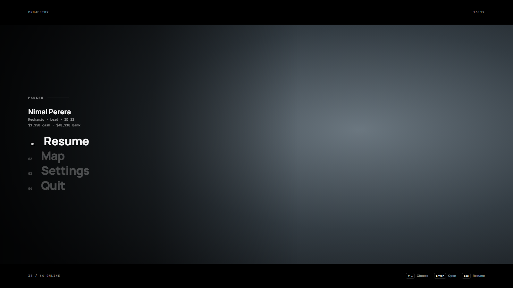

# Project07_FreePause

Free pause menu for Qbox. ESC or P opens a clean text list on the left with your name, job, money and server id. No admin panel, buttons are in `config.lua`.

## Features
- ESC and P open and close it; GTA's own pause menu never shows over it.
- Resume, Map (full-screen map, back / ESC / P closes it), Settings (the GTA settings), Quit (asks twice).
- Background blur, players online, clock.
- Discord log when someone quits from the menu.

## Requirements
- [qbx_core](https://github.com/Qbox-project/qbx_core)
- [ox_lib](https://github.com/overextended/ox_lib)
- [Project7H_Lib](https://github.com/PehesaraNimnad/Project7H_Lib/releases/latest) (framework / appearance / weather / spawn layer)

## Installation
1. Put `Project07_FreePause` in your `resources` folder.
2. Add to `server.cfg` after the requirements:
   ```
   ensure Project07_FreePause
   ```
3. Change the server name, blur and buttons in `config.lua`.
4. Optional: Discord webhook in `sv_config.lua`.

Do not run it together with another pause menu script.

## Building the UI (only if you change it)
```
cd web
npm install
npx vite build --mode pause
```
Copy `build/pause` to `web/build`.

## Preview


